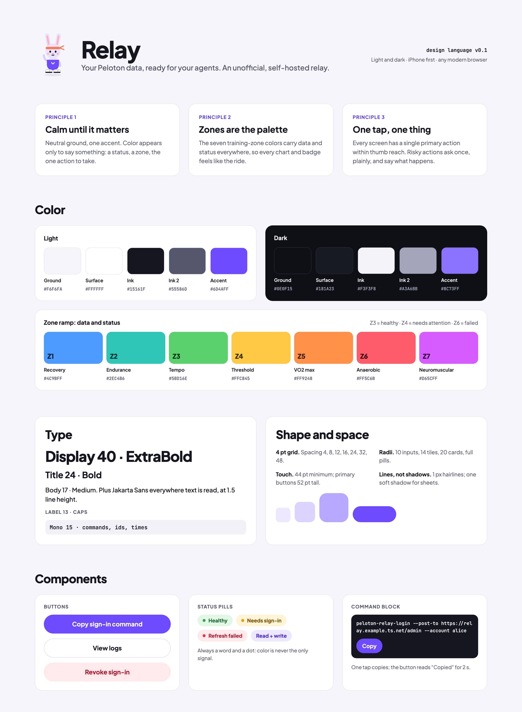
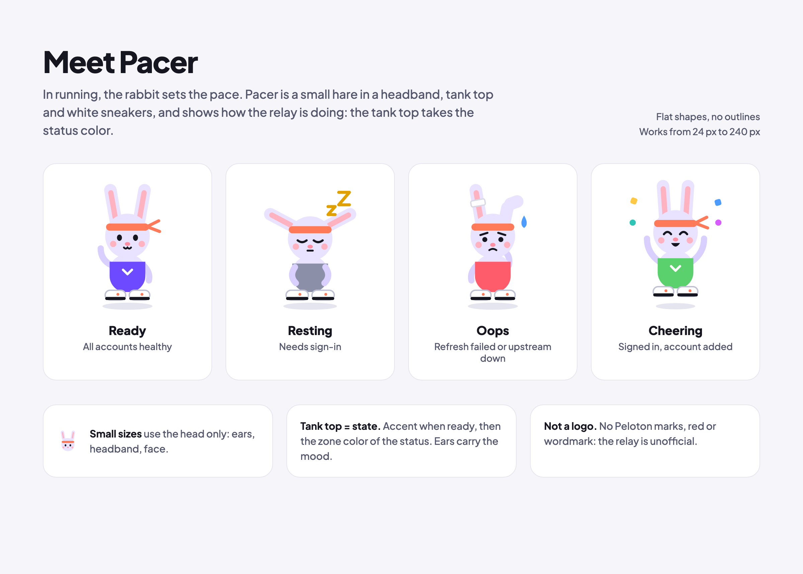
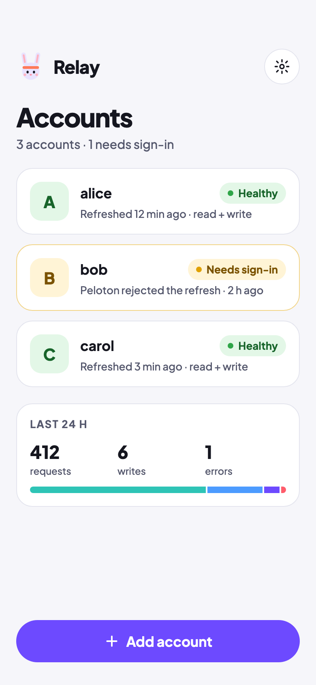
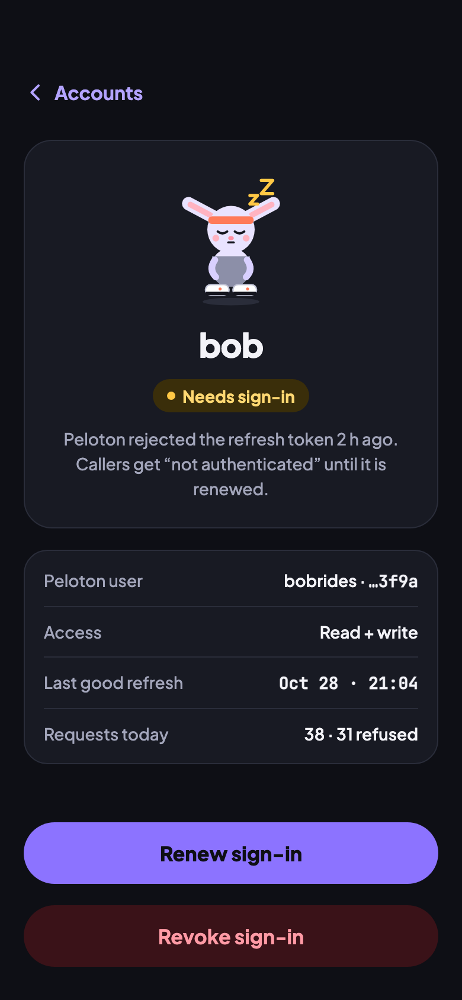
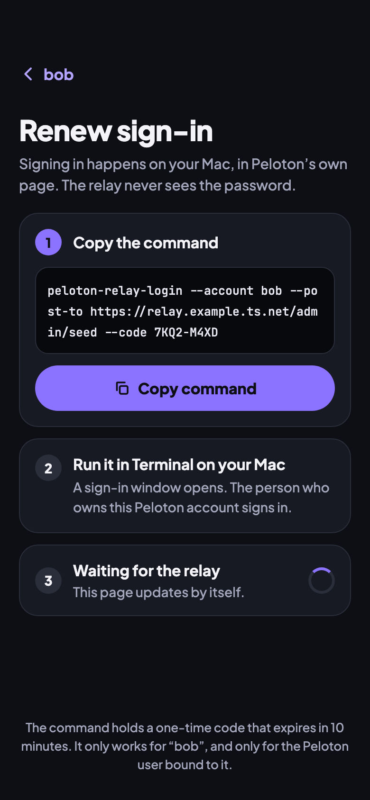
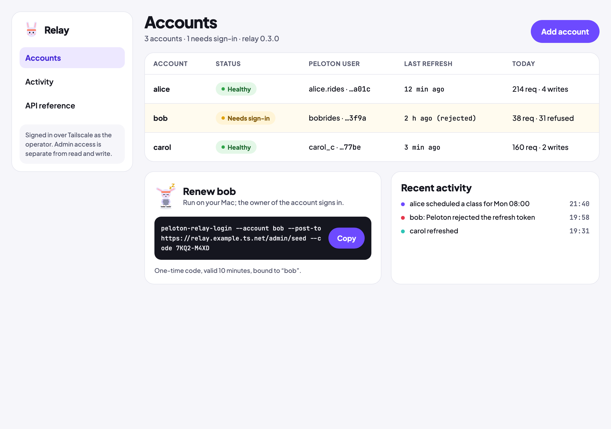

# Relay design language

Version 0.1. The look of every page the relay serves, starting with the admin page (#20). Light and dark, iPhone first, any modern browser.

## Principles

1. **Calm until it matters.** Neutral ground and one accent. Color only appears when it says something: a status, a zone, or the one action to take.
2. **Zones are the palette.** The seven training-zone colors carry data and status everywhere, so every chart and badge feels like the ride.
3. **One tap, one thing.** Every screen has a single primary action within thumb reach. Risky actions ask once, in plain words, and say what will happen.

## Tokens

Every value is in [`tokens.json`](tokens.json). Pages read them as CSS custom properties. Dark mode follows `prefers-color-scheme`, and a stored choice overrides it.

| | Light | Dark |
|---|---|---|
| Ground | `#F6F6FA` | `#0E0F15` |
| Surface | `#FFFFFF` | `#181A23` |
| Ink / Ink 2 | `#15161F` / `#55586D` | `#F3F3F8` / `#A3A6BB` |
| Line | `#E4E5EE` | `#2A2D3A` |
| Accent | `#6D4AFF` | `#8C73FF` |

**Zones (Z1–Z7):**

| Zone | Name | Color |
|---|---|---|
| Z1 | Recovery | `#4C9BFF` |
| Z2 | Endurance | `#2EC4B6` |
| Z3 | Tempo | `#5BD16E` |
| Z4 | Threshold | `#FFC845` |
| Z5 | VO2 max | `#FF9248` |
| Z6 | Anaerobic | `#FF5C6B` |
| Z7 | Neuromuscular | `#D65CFF` |

**Status** uses three zones: healthy is Z3, needs sign-in is Z4, failed is Z6. A status is always a word plus a dot, never color alone.

**Type:**
- Plus Jakarta Sans: display 40/800, title 24/700, body 17/500 at 1.5 line height, label 13/700 in caps.
- JetBrains Mono: commands, ids and times.

**Shape:**
- Spacing: 4 pt grid (4, 8, 12, 16, 24, 32, 48).
- Radii: 10 for inputs, 14 for tiles, 20 for cards, full for pills.
- Touch targets: at least 44 pt; primary buttons are 52 pt tall.
- Hairlines rather than shadows.

**Accessibility:**
- Text meets 4.5:1 contrast in both themes.
- Real `<button>`, `<a>` and `<label>` elements, and an `aria-label` on every icon-only control.

## Pacer, the mascot

In running, the rabbit sets the pace. Pacer is a small hare in a headband, a tank top and white sneakers, drawn as flat shapes with no outlines.

Pacer shows how the relay is doing. The tank top takes the status color, and the ears carry the mood.

| File | Mood | When |
|---|---|---|
| [`pacer/ready.svg`](pacer/ready.svg) | Ready (accent) | All accounts healthy |
| [`pacer/resting.svg`](pacer/resting.svg) | Resting (grey) | An account needs sign-in |
| [`pacer/oops.svg`](pacer/oops.svg) | Oops (Z6) | A refresh failed, or Peloton is down |
| [`pacer/cheering.svg`](pacer/cheering.svg) | Cheering (Z3) | Signed in, account added |
| [`pacer/face.svg`](pacer/face.svg) | Head only | Icons and headers, 24–48 px |

Pacer is not a logo. The relay is unofficial: no Peloton marks, red or wordmark.

## Admin page mockups

Static HTML in [`mockups/`](mockups). Open one in a browser to inspect it.

| iPhone, light | iPhone, dark | Renew: copy the command |
|---|---|---|
|  |  |  |

The browser layout also works at phone width: the navigation stacks and the table scrolls inside its box. See [`screenshots/browser-admin-narrow.png`](screenshots/browser-admin-narrow.png).

Account names, Peloton users and activity in the mockups are invented.
